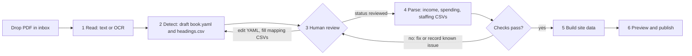

# Portable engine: map of the new files

The site is becoming a portable engine: drop a budget PDF into a folder and get the dashboard for any City, County or School District, by editing only YAML and CSV files. This page lists the files Phase 0 added, what each is for, who edits it and which are generated. The working plan is [PLAN.md](PLAN.md); every field is described in [CONFIG.md](CONFIG.md).

**Phase 0 changes nothing the site or the pipeline does.** The new files describe Lancaster City and County as they are today and are checked by `scripts/validate_config.py`; the build, the checks and the website still read `web/config.json`, `config/*.json` and `data/*.csv`. Later phases switch them over one at a time, each proven by the parity check.

## The process (target)

Steps 1, 2 and 3's review page arrive in Phase 4; today a new book still goes through `scripts/ingest.py` (see `docs/PIPELINE.md`).

## Files you edit

| File | What it is for | Who edits it |
|---|---|---|
| `site.yaml` | The whole site: title, contact address, repository, which governments appear and in what order, the government `/` opens on, the tax estimate page settings. | Site owner |
| `governments/<id>/government.yaml` | One government: names, kind, web address prefix (`city`, `county`, `school`), fiscal year and how a year is written, where its PDFs and data live, which figure is shown for each year, optional pages (`auto`, `on`, `off`), words and site text. Today: `lancaster-city`, `lancaster-county`. | Whoever onboards the government |
| `kinds/city.yaml`, `kinds/county.yaml`, `kinds/school_district.yaml` | Default words for each kind of government (who passes the budget, what a department and a unit are called, figure labels). A government's own `vocabulary` overrides them. The school district file holds generic words only, each to be confirmed from the district's own documents. | Rarely; shared by every government of that kind |
| `config/portable_allowlist.csv` | Reviewed exceptions for `check_portable.py` (`file,category,pattern,reason`). Empty for now. | Whoever reviews a portability exception |
| `governments/<id>/books/*.yaml`, `content/calendar.yaml`, `content/rules/tax_limit.yaml` | Not created yet. Their formats exist (`schemas/`) and are checked when present: books arrive in Phases 1 and 2 (from `config/*.json`), the calendar in Phase 3, the tax limit rule in Phase 1. | Reviewer of each PDF; whoever writes the calendar |

## Files that check and describe the others

| File | What it is for | Edited by hand? |
|---|---|---|
| `schemas/*.schema.json` | The format of each YAML file (JSON Schema): which fields exist, which are required, allowed values, and a plain description of each. | Yes, when a format changes (then regenerate CONFIG.md) |
| `schemas/csv/*.schema.json` | The format of each hand-kept CSV: required columns, value forms (page number, account code, one of a list). | Yes, same as above |
| `docs/portable/CONFIG.md` | Every field of every file: meaning, type, required, example. | **No: generated** by `scripts/docs_config.py` from the schemas |
| `docs/portable/baseline-inventory.csv` | The list of hardcoded values in engine code at `6693955`, the starting point. | No: a record |

## Scripts

| Script | What it does | Exit status |
|---|---|---|
| `scripts/validate_config.py` | Checks every YAML file, today's `config/*.json` book configs and `governments/lancaster-city/content/rules/tax_limit.yaml`, and every hand-kept CSV against its schema. One line per problem naming the file, field or CSV line and column, and what was expected. `--file PATH` checks one file; `--list` shows which schema checks which file. | 0 valid, 1 problems |
| `scripts/govconfig.py` | The loader later phases use: `load_site()`, `load_government(id)`, `list_governments()`, `vocabulary()`, `book_config(gov, pdf)`, path helpers. Checks each file against its schema on load and raises `ConfigError` with plain messages. | (library) |
| `scripts/check_portable.py` | Lists government names, years, funds, departments, account codes, file names and wording still written into engine code (`scripts/*.py`, `web/app.js`, `web/index.html`, `pages.yml`), per file and category. Report only; `--strict` will fail CI from Phase 3. `--csv` writes every hit. | 0 (1 with `--strict` and hits) |
| `scripts/parity.py` | `snapshot <git-ref> <dir>` saves the generated data at a commit; `compare <dir>` proves the working tree's `web/data` JSON and `data/processed` CSVs are unchanged (ignoring the build time). Every refactor phase must pass it. | 0 equal, 1 differences |
| `scripts/docs_config.py` | Regenerates `CONFIG.md` from the schemas; `--check` fails when it is out of date. | 0 / 1 |

Run them with the project venv (`.venv/bin/python`); `validate_config.py` and `govconfig.py` need PyYAML and jsonschema, pinned in `requirements.txt` and `requirements-build.txt`.

## Generated folders to come

| Folder | Generated by | Phase |
|---|---|---|
| `governments/<id>/data/` | parse step: spending, income, staffing, balance CSVs | 1 and 2 |
| `governments/<id>/review/<book>/` | read/detect/review steps: page text, word positions, headings, checks, review page | 4 |
| `web/data/manifest.json` | build: governments, routes, labels, features present | 3 |

## Owner check for Phase 0

1. Open `governments/lancaster-city/government.yaml` and read it against the live site.
2. Run `.venv/bin/python scripts/validate_config.py` (expect `OK`).
3. Copy the city file somewhere outside the repo, change `kind: city` to `kind: town`, run `.venv/bin/python scripts/validate_config.py --file <copy>` and read the message.
4. Read `docs/portable/CONFIG.md`.
